  <picture>
    <source media="(prefers-color-scheme: dark)" srcset="./assets/board-dark.svg">
    
  </picture>

 

I'm a bachelor's student with only my thesis left to go. I work AI-native from
start to finish: I design the software, direct AI agents to build it, and
review what they produce. The goal is always something other people can install
and use. Here is what I'm working on.

## [llama-server-launcher](https://github.com/gabrieljakob/llama-server-launcher)

An interactive terminal board for llama.cpp's `llama-server`. Named configs,
every setting on a numbered board, one keypress to launch. The
[latest release](https://github.com/gabrieljakob/llama-server-launcher/releases/latest)
installs with one line on Windows, Linux and macOS.

It was built AI-native: the design documents and implementation plans the
agents worked from are in the repo's
[`docs/`](https://github.com/gabrieljakob/llama-server-launcher/tree/main/docs)
folder.

**What comes next**

- Neutral defaults and presets, so a fresh install fits any machine and not just mine
- A full terminal UI built on [Textual](https://textual.textualize.io/)
- Config export and import, to hand a working setup to someone else

## slm-router-bench

An upcoming benchmark built around one fixed task. It asks how much of the work
a small model on a consumer GPU can do instead of a paid frontier model, how
much quantization, context window, reasoning and constrained output change the
result, and when a router should hand a request up to the bigger model.

It is still in design, so there are no results yet.
